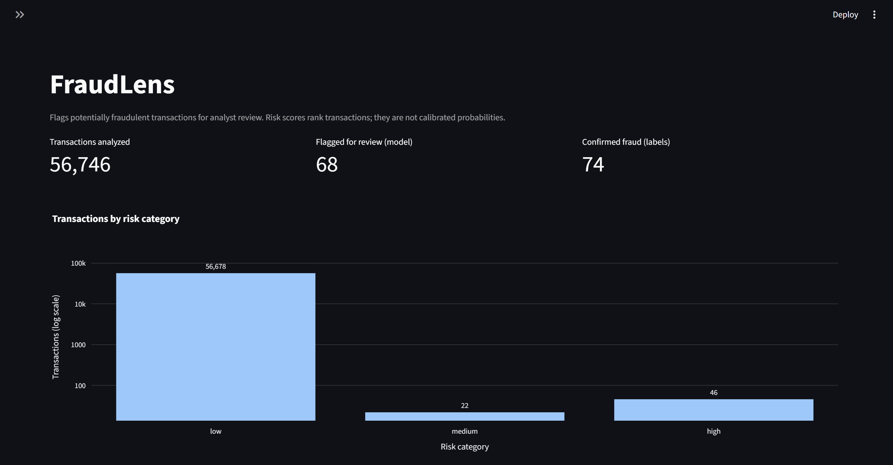
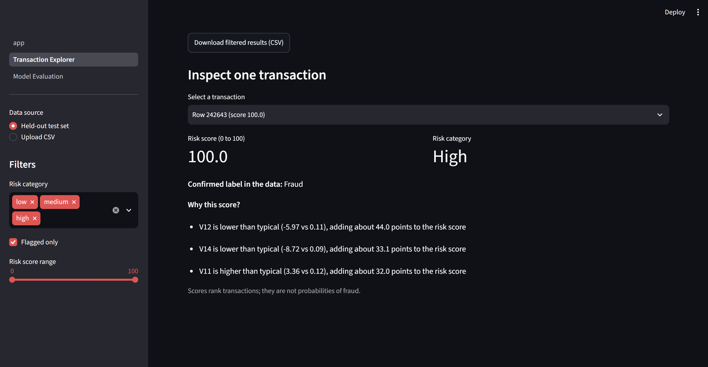
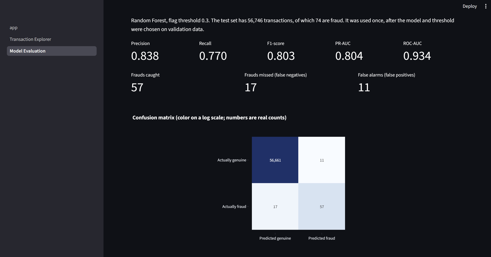

# FraudLens: Financial Fraud Detection and Risk Analysis

A machine learning application that scores card transactions from 0 to 100 and flags suspicious ones for analyst review, with a short explanation of what pushed each score up. Built with Python, scikit-learn and Streamlit.

**Status:** working locally. Not yet deployed. [Add the live link here once it is.]



## Problem

Card fraud is rare but expensive. Fewer than 0.2% of transactions in the dataset used here are fraudulent, so a model that flags nothing is 99.9% accurate and useless. The goal is to rank transactions so analysts can review the riskiest ones first, and to measure how well that works with metrics that suit rare events.

## What it does

- Scores transactions with a Random Forest and shows a 0 to 100 risk score with low, medium and high categories.
- Flags transactions at or above a threshold chosen on validation data.
- Explains each flag by showing which features pushed the score up.
- Lets you filter transactions, upload your own CSV with validation and clear error messages, and download results.
- Shows offline evaluation results on held-out data.



## Dataset

[Credit Card Fraud Detection](https://www.kaggle.com/datasets/mlg-ulb/creditcardfraud), from Worldline and the ULB Machine Learning Group, under the Database Contents License (DbCL) v1.0. It holds 284,807 transactions over two days in September 2013, with 492 frauds (0.172%). The file is not included in this repository. Download it and place it at `data/creditcard.csv`.

Columns: `Time` (seconds since the first transaction), `V1` to `V28` (anonymized by PCA), `Amount`, `Class` (1 = fraud).

Limitations: the V columns cannot be interpreted, there is no merchant, location or customer history, and the data covers only two days.

## Method

1. Validation and cleaning: removed 1,081 exact duplicate rows (19 of them fraud) so they cannot appear in both training and test data. This leaves 283,726 rows with 473 frauds.
2. Time-based split: the earliest 60% of transactions for training, the next 20% for validation, the last 20% for testing, because a real system predicts the future from the past.
3. Two models compared on validation data: Logistic Regression (baseline) and Random Forest, both with class weights for the rare fraud class.
4. Threshold chosen on validation data from assumed costs of 100 per missed fraud and 2 per false alarm. Real costs would come from the business.
5. The test set was used once, after choosing the model and threshold.

## Results

Validation set (57 frauds):

| Model | Threshold | Precision | Recall | PR-AUC | False alarms | Missed |
|---|---|---|---|---|---|---|
| Logistic Regression | 0.95 | 0.241 | 0.807 | 0.773 | 145 | 11 |
| Random Forest | 0.30 | 0.827 | 0.754 | 0.762 | 9 | 14 |

The two models rank fraud about equally well. The Random Forest was chosen because it needs about 52 alerts reviewed instead of about 191 for a similar number of caught frauds.

Held-out test set (74 frauds), Random Forest at threshold 0.3: 57 caught, 17 missed, 11 false alarms. Precision 0.838, recall 0.770, PR-AUC 0.804.



These are offline results from a small number of fraud cases, so they are noisy. They are not a measure of live performance.

## Install and run

```
git clone https://github.com/VikasiniMurugesan/FraudLens.git
cd FraudLens
python -m venv .venv
.venv\Scripts\Activate.ps1
pip install -r requirements.txt
streamlit run app.py
```

The trained model is included in `models/`. Without `data/creditcard.csv`, choose **Upload CSV** in the app and upload a file with columns `V1` to `V28` and `Amount`. The held-out test set option needs the Kaggle file.

To retrain: place the dataset in `data/` and run `python -m src.train_model`.

## Tests

```
pytest -q
```

38 automated tests cover data validation, the time-based split, risk scoring, predictions, explanations and CSV upload checks.

## Project structure

```
app.py                      main page
pages/                      Transaction Explorer, Model Evaluation
src/data_loader.py          loading and validation
src/preprocessing.py        time-based split
src/train_model.py          training and evaluation
src/predict.py              scoring with the saved model
src/risk_scoring.py         0-100 score and categories
src/explainability.py       per-transaction reasons
src/synthetic_data.py       simulated demo transactions
tests/                      pytest tests
```

## Limitations and ethics

- Risk scores are rankings, not calibrated probabilities.
- A flag is a reason for human review, not proof of fraud. False alarms inconvenience real customers.
- The explanations show what the model relied on, not what causes fraud.
- `data/sample_transactions.csv` is simulated, with fraud patterns planted by the generator, and is not scored by the real model.

## Future work

Calibrated probabilities, gradient boosting, SHAP explanations, an analyst alert workflow with saved decisions, a demo model for the synthetic data, drift monitoring, and a React and Spring Boot version.